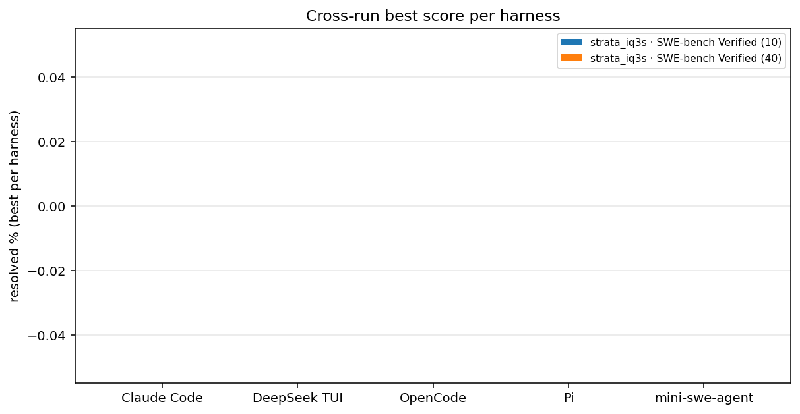

# Leaderboard — best score per harness (cross-run)

Derived from every run below; the best rate per (model, bench, harness) wins.
Regenerate: `python3 scripts/aggregate.py`. Each run's own numbers stay in `runs/<slug>/run.md`.

## strata_iq3s — SWE-bench Verified (10)

| Harness | Best resolved | Best rate | Resolved/GPU-h | Achieved in |
|---|---|---|---|---|
| mini-swe-agent | 5/10 | **50.0%** | 4.88 | [2026-11-17](runs/2026-11-17-strata-iq3s-sb10-5way/run.md) |
| Claude Code | 5/10 | **50.0%** | 4.58 | [2026-11-17](runs/2026-11-17-strata-iq3s-sb10-5way/run.md) |
| Pi | 5/10 | **50.0%** | 3.30 | [2026-11-17](runs/2026-11-17-strata-iq3s-sb10-5way/run.md) |
| DeepSeek TUI | 5/10 | **50.0%** | 3.72 | [2026-11-17](runs/2026-11-17-strata-iq3s-sb10-5way/run.md) |
| OpenCode | 5/10 | **50.0%** | 6.22 | [2026-11-17](runs/2026-11-17-strata-iq3s-sb10-5way/run.md) |

## strata_iq3s — SWE-bench Verified (40)

| Harness | Best resolved | Best rate | Resolved/GPU-h | Achieved in |
|---|---|---|---|---|
| OpenCode | 35/40 | **87.5%** | 4.13 | [2026-11-18](runs/2026-11-18-strata-iq3s-sb40-5way/run.md) |
| Claude Code | 34/40 | **85.0%** | 5.22 | [2026-11-18](runs/2026-11-18-strata-iq3s-sb40-5way/run.md) |
| Pi | 32/40 | **80.0%** | 3.80 | [2026-11-18](runs/2026-11-18-strata-iq3s-sb40-5way/run.md) |
| mini-swe-agent | 26/40 | **65.0%** | 1.98 | [2026-11-18](runs/2026-11-18-strata-iq3s-sb40-5way/run.md) |
| DeepSeek TUI | 24/40 | **60.0%** | 3.12 | [2026-11-18](runs/2026-11-18-strata-iq3s-sb40-5way/run.md) |

