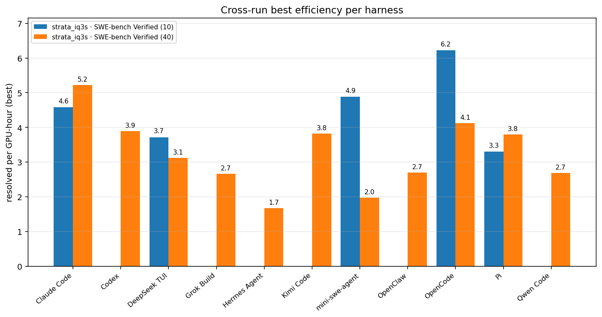

# Leaderboard — best score per harness (cross-run)

Derived from every run; the best value per (model, bench, harness) **per metric** wins.
Regenerate: `python3 scripts/aggregate.py`. Each run's own numbers stay in `runs/<slug>/run.md`.

## strata_iq3s — SWE-bench Verified (10)

**Resolved rate (higher = better)**

| Harness | Best of 10 | Achieved in |
|---|---|---|
| mini-swe-agent | **50.0%** | [2026-11-17](runs/2026-11-17-strata-iq3s-sb10-5way/run.md) |
| Claude Code | **50.0%** | [2026-11-17](runs/2026-11-17-strata-iq3s-sb10-5way/run.md) |
| Pi | **50.0%** | [2026-11-17](runs/2026-11-17-strata-iq3s-sb10-5way/run.md) |
| DeepSeek TUI | **50.0%** | [2026-11-17](runs/2026-11-17-strata-iq3s-sb10-5way/run.md) |
| OpenCode | **50.0%** | [2026-11-17](runs/2026-11-17-strata-iq3s-sb10-5way/run.md) |

**Efficiency — resolved per GPU-hour (higher = better)**

| Harness | Best resolved/GPU-h | Achieved in |
|---|---|---|
| OpenCode | **6.22** | [2026-11-17](runs/2026-11-17-strata-iq3s-sb10-5way/run.md) |
| mini-swe-agent | **4.88** | [2026-11-17](runs/2026-11-17-strata-iq3s-sb10-5way/run.md) |
| Claude Code | **4.58** | [2026-11-17](runs/2026-11-17-strata-iq3s-sb10-5way/run.md) |
| DeepSeek TUI | **3.72** | [2026-11-17](runs/2026-11-17-strata-iq3s-sb10-5way/run.md) |
| Pi | **3.30** | [2026-11-17](runs/2026-11-17-strata-iq3s-sb10-5way/run.md) |

**Leanest total wall time (lower = better)**

| Harness | Best wall (sum) | Achieved in |
|---|---|---|
| OpenCode | 0.80 h | [2026-11-17](runs/2026-11-17-strata-iq3s-sb10-5way/run.md) |
| mini-swe-agent | 1.02 h | [2026-11-17](runs/2026-11-17-strata-iq3s-sb10-5way/run.md) |
| Claude Code | 1.09 h | [2026-11-17](runs/2026-11-17-strata-iq3s-sb10-5way/run.md) |
| DeepSeek TUI | 1.34 h | [2026-11-17](runs/2026-11-17-strata-iq3s-sb10-5way/run.md) |
| Pi | 1.52 h | [2026-11-17](runs/2026-11-17-strata-iq3s-sb10-5way/run.md) |

**Leanest traffic — LLM calls / input tokens (lower = better)**

| Harness | Best calls | Best input tok | Achieved in |
|---|---|---|---|
| mini-swe-agent | 366 | 9.00M | [2026-11-17](runs/2026-11-17-strata-iq3s-sb10-5way/run.md) |
| Claude Code | 484 | 12.80M | [2026-11-17](runs/2026-11-17-strata-iq3s-sb10-5way/run.md) |
| OpenCode | 485 | 11.83M | [2026-11-17](runs/2026-11-17-strata-iq3s-sb10-5way/run.md) |
| DeepSeek TUI | 506 | 13.16M | [2026-11-17](runs/2026-11-17-strata-iq3s-sb10-5way/run.md) |
| Pi | 555 | 14.53M | [2026-11-17](runs/2026-11-17-strata-iq3s-sb10-5way/run.md) |

## strata_iq3s — SWE-bench Verified (40)

**Resolved rate (higher = better)**

| Harness | Best of 40 | Achieved in |
|---|---|---|
| OpenCode | **87.5%** | [2026-11-18](runs/2026-11-18-strata-iq3s-sb40-5way/run.md) |
| Claude Code | **85.0%** | [2026-11-18](runs/2026-11-18-strata-iq3s-sb40-5way/run.md) |
| Qwen Code | **85.0%** | [2026-11-19](runs/2026-11-19-strata-iq3s-sb40-6way-new/run.md) |
| Kimi Code | **85.0%** | [2026-11-19](runs/2026-11-19-strata-iq3s-sb40-6way-new/run.md) |
| Pi | **80.0%** | [2026-11-18](runs/2026-11-18-strata-iq3s-sb40-5way/run.md) |
| Codex | **77.5%** | [2026-11-19](runs/2026-11-19-strata-iq3s-sb40-6way-new/run.md) |
| Grok Build | **75.0%** | [2026-11-19](runs/2026-11-19-strata-iq3s-sb40-6way-new/run.md) |
| OpenClaw | **70.0%** | [2026-11-19](runs/2026-11-19-strata-iq3s-sb40-6way-new/run.md) |
| mini-swe-agent | **65.0%** | [2026-11-18](runs/2026-11-18-strata-iq3s-sb40-5way/run.md) |
| DeepSeek TUI | **60.0%** | [2026-11-18](runs/2026-11-18-strata-iq3s-sb40-5way/run.md) |
| Hermes Agent | **27.5%** | [2026-11-19](runs/2026-11-19-strata-iq3s-sb40-6way-new/run.md) |

**Efficiency — resolved per GPU-hour (higher = better)**

| Harness | Best resolved/GPU-h | Achieved in |
|---|---|---|
| Claude Code | **5.22** | [2026-11-18](runs/2026-11-18-strata-iq3s-sb40-5way/run.md) |
| OpenCode | **4.13** | [2026-11-18](runs/2026-11-18-strata-iq3s-sb40-5way/run.md) |
| Codex | **3.90** | [2026-11-19](runs/2026-11-19-strata-iq3s-sb40-6way-new/run.md) |
| Kimi Code | **3.82** | [2026-11-19](runs/2026-11-19-strata-iq3s-sb40-6way-new/run.md) |
| Pi | **3.80** | [2026-11-18](runs/2026-11-18-strata-iq3s-sb40-5way/run.md) |
| DeepSeek TUI | **3.12** | [2026-11-18](runs/2026-11-18-strata-iq3s-sb40-5way/run.md) |
| OpenClaw | **2.70** | [2026-11-19](runs/2026-11-19-strata-iq3s-sb40-6way-new/run.md) |
| Qwen Code | **2.69** | [2026-11-19](runs/2026-11-19-strata-iq3s-sb40-6way-new/run.md) |
| Grok Build | **2.67** | [2026-11-19](runs/2026-11-19-strata-iq3s-sb40-6way-new/run.md) |
| mini-swe-agent | **1.98** | [2026-11-18](runs/2026-11-18-strata-iq3s-sb40-5way/run.md) |
| Hermes Agent | **1.68** | [2026-11-19](runs/2026-11-19-strata-iq3s-sb40-6way-new/run.md) |

**Leanest total wall time (lower = better)**

| Harness | Best wall (sum) | Achieved in |
|---|---|---|
| Claude Code | 6.51 h | [2026-11-18](runs/2026-11-18-strata-iq3s-sb40-5way/run.md) |
| Hermes Agent | 6.55 h | [2026-11-19](runs/2026-11-19-strata-iq3s-sb40-6way-new/run.md) |
| DeepSeek TUI | 7.69 h | [2026-11-18](runs/2026-11-18-strata-iq3s-sb40-5way/run.md) |
| Codex | 7.94 h | [2026-11-19](runs/2026-11-19-strata-iq3s-sb40-6way-new/run.md) |
| Pi | 8.42 h | [2026-11-18](runs/2026-11-18-strata-iq3s-sb40-5way/run.md) |
| OpenCode | 8.48 h | [2026-11-18](runs/2026-11-18-strata-iq3s-sb40-5way/run.md) |
| Kimi Code | 8.90 h | [2026-11-19](runs/2026-11-19-strata-iq3s-sb40-6way-new/run.md) |
| OpenClaw | 10.36 h | [2026-11-19](runs/2026-11-19-strata-iq3s-sb40-6way-new/run.md) |
| Grok Build | 11.24 h | [2026-11-19](runs/2026-11-19-strata-iq3s-sb40-6way-new/run.md) |
| Qwen Code | 12.64 h | [2026-11-19](runs/2026-11-19-strata-iq3s-sb40-6way-new/run.md) |
| mini-swe-agent | 13.15 h | [2026-11-18](runs/2026-11-18-strata-iq3s-sb40-5way/run.md) |

**Leanest traffic — LLM calls / input tokens (lower = better)**

| Harness | Best calls | Best input tok | Achieved in |
|---|---|---|---|
| Hermes Agent | 1,596 | 48.09M | [2026-11-19](runs/2026-11-19-strata-iq3s-sb40-6way-new/run.md) |
| DeepSeek TUI | 1,865 | 56.17M | [2026-11-18](runs/2026-11-18-strata-iq3s-sb40-5way/run.md) |
| OpenClaw | 1,878 | 71.04M | [2026-11-19](runs/2026-11-19-strata-iq3s-sb40-6way-new/run.md) |
| Codex | 1,967 | 59.76M | [2026-11-19](runs/2026-11-19-strata-iq3s-sb40-6way-new/run.md) |
| Pi | 2,010 | 51.32M | [2026-11-18](runs/2026-11-18-strata-iq3s-sb40-5way/run.md) |
| Claude Code | 2,035 | 65.95M | [2026-11-18](runs/2026-11-18-strata-iq3s-sb40-5way/run.md) |
| Kimi Code | 2,067 | 76.89M | [2026-11-19](runs/2026-11-19-strata-iq3s-sb40-6way-new/run.md) |
| Qwen Code | 2,323 | 89.41M | [2026-11-19](runs/2026-11-19-strata-iq3s-sb40-6way-new/run.md) |
| OpenCode | 2,334 | 80.70M | [2026-11-18](runs/2026-11-18-strata-iq3s-sb40-5way/run.md) |
| Grok Build | 2,422 | 85.47M | [2026-11-19](runs/2026-11-19-strata-iq3s-sb40-6way-new/run.md) |
| mini-swe-agent | 2,511 | 62.88M | [2026-11-18](runs/2026-11-18-strata-iq3s-sb40-5way/run.md) |

