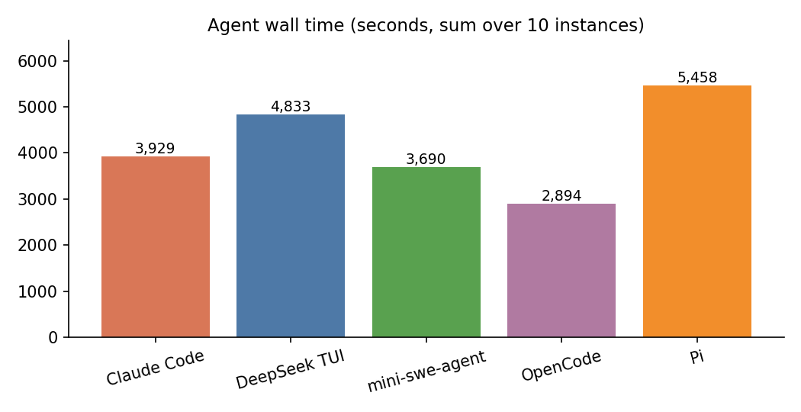
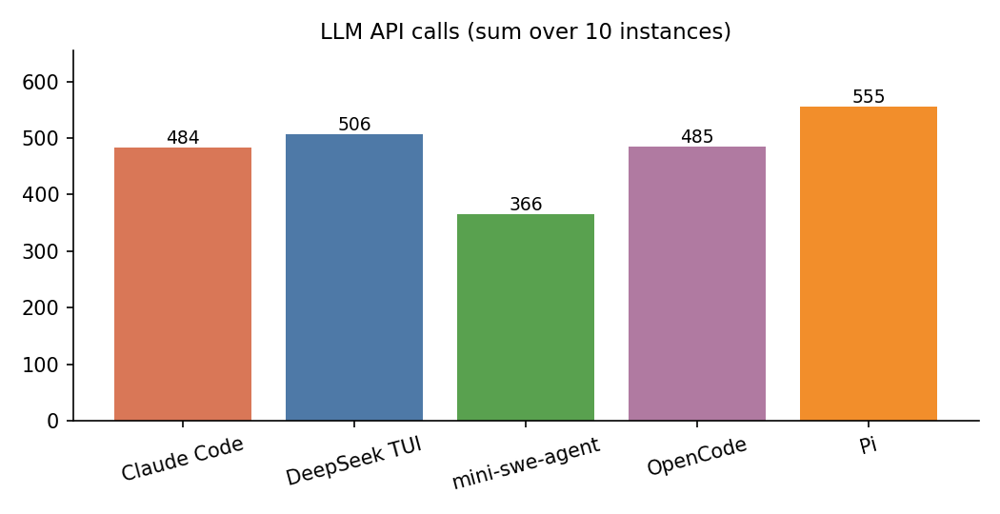
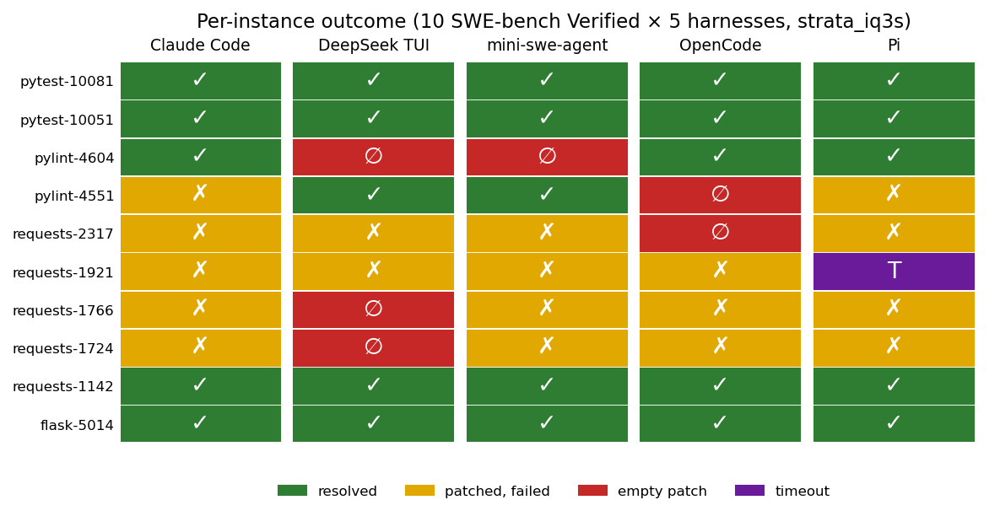

# Run 2026-11-17 — strata_iq3s × 5 coding harnesses on SWE-bench Verified (10)

**Question:** with the *model held fixed*, which coding harness gets the most solved tasks per unit of work?

## Run card

| | |
|---|---|
| Date | 2026-11-17 (sweep 07:40 → 10:48 UTC, grading until 12:29) |
| Model (fixed) | `strata_iq3s` (Qwen3.8-27B IQ3_S) via llama-swap `127.0.0.1:8080` |
| Serving | strata 0.2.13, `--context 128k --parallel 2 --kv k8v4 --mtp`, T=0 |
| Env-var experiment | `STRATA_ROUTE_PRIOR=0 STRATA_ROUTE_TAIL_SKIP=0` active (bench8 showed zero effect) |
| Benchmark | 10 SWE-bench Verified instances (`sb10_new.json`), official swebench grader (F2P/P2P), graded **outside** the harness |
| Agent loop | headless, inside the official `swebench/sweb.eval.x86_64.*` image, per-instance timeout 1800 s |
| Harnesses | Claude Code 2.1.326 · DeepSeek TUI (dsh) 0.2.2-rc.3 · mini-swe-agent 2.x · OpenCode 2.3.0 · Pi 1.5.2 |
| Telemetry | llama-swap activity ring (per-request token counts) + per-instance wall windows |
| Repo tooling | `hb.py` (run/eval/report), `scripts/consolidate.py`, `scripts/render_charts.py` |

## Headline results

## Per-instance outcomes

| Harness | Resolved | Patched but failed | Empty patch | Timeout | Wall (s) | API calls | Input tok | Output tok | Resolved/GPU·h |
|---|---|---|---|---|---|---|---|---|---|
| Claude Code 2.1.326 | **5/10** | 5 | 0 | 0 | 3,924 | 484 | 12.80M | 213K | 4.58 |
| DeepSeek TUI 0.2.2 | **5/10** | 2 | 3 | 0 | 4,824 | 506 | 13.16M | 195K | 3.72 |
| mini-swe-agent | **5/10** | 4 | 1 | 0 | 3,672 | 366 | 8.997M | 153K | 4.88 |
| OpenCode 2.3.0 | **5/10** | 3 | 2 | 0 | 2,880 | 485 | 11.83M | 163K | **6.22** |
| Pi 1.5.2 | **5/10** | 3 | 1 | 1 | 5,472 | 555 | 14.53M | 193K | 3.30 |

## Findings

1. **Pass rate is harness-insensitive at n=10.** All five harnesses solved the same 4 instances (flask-5014, requests-1142, pytest-10051, pytest-10081) and all failed requests-1724/1766/1921/2317. The only divergence is the pylint tie: 4604 (claude/opencode/pi) vs 4551 (dsh/mini) — sampling noise, not capability.
2. **Efficiency separates them 2×.** OpenCode: fastest wall-clock (0.80 h) and best resolved-per-GPU-hour (6.22). Pi: slowest and most expensive (555 calls, 14.5M input tok) for the same 5 solves.
3. **mini-swe-agent is the leanest loop:** ~34–40% fewer API calls and input tokens than the commercial harnesses, at equal pass rate — it burns almost no context overhead per step.
4. **Claude Code is the most reliable loop:** the only harness that submitted a non-empty patch on *every* instance (0 empties, 0 timeouts). DeepSeek TUI is the least reliable (3 empties).
5. Caveat: n=10, one sample per harness, T=0 but batch-scheduling at `--parallel 2` leaves ±1 noise. Pass-rate ranking needs repeats or ≥30 instances; the cost/robustness ranking above is already decisive.

## Data

- `data/results.json` — consolidated numbers (this page's tables/charts are generated from it)
- `data/eval_*.json` — official swebench reports per harness
- `data/preds_*.json` — model patches per instance (grading inputs)
- `data/windows_*.jsonl`, `data/activity_*.jsonl` — raw telemetry
- Reproduce: `hb.py run --harness <name> && hb.py eval --harness <name>` then `scripts/consolidate.py && scripts/render_charts.py`
