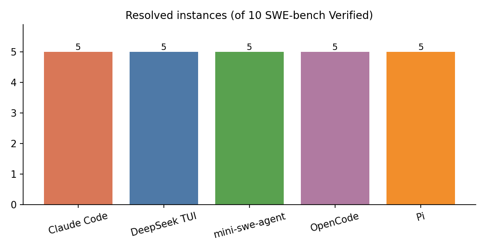
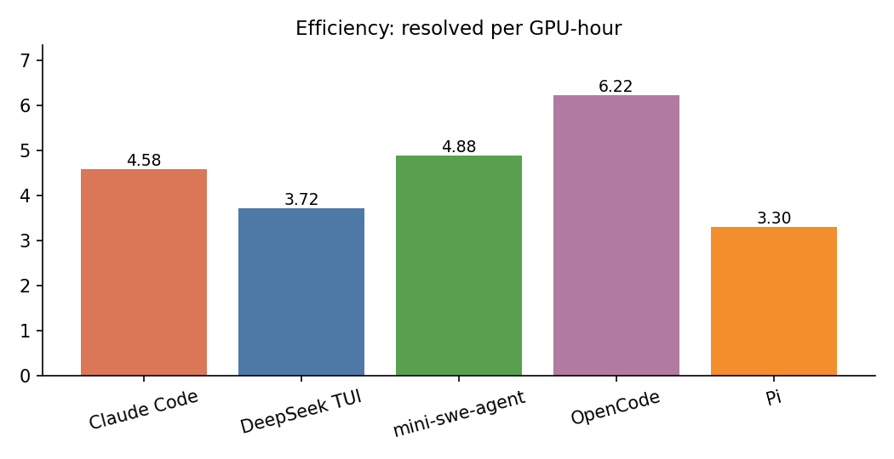
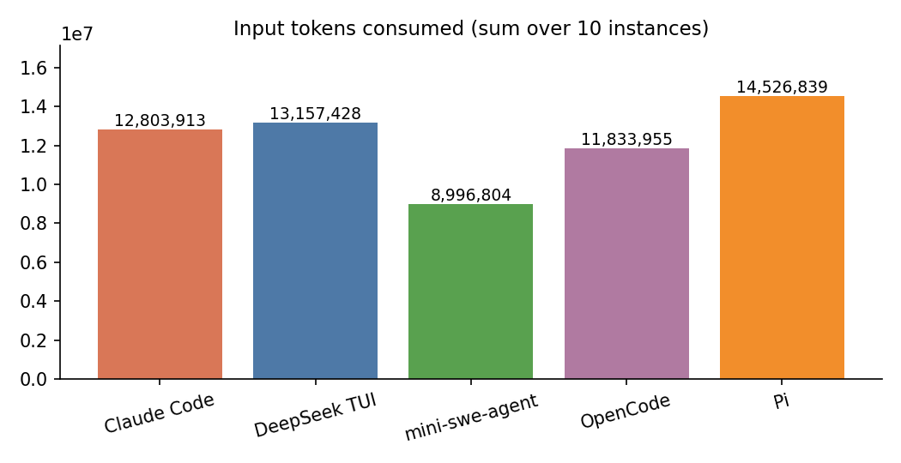

# Run 2026-11-17 — strata_iq3s × 5 harnesses, SWE-bench Verified (10)

**Question:** with the *model held fixed*, which coding harness gets the most solved tasks per unit of work?

## Run card

| | |
|---|---|
| Date | 2026-11-17 (sweep 07:40 → 10:48 UTC, grading until 12:29) |
| Model (fixed) | `strata_iq3s` (Qwen3.8-27B IQ3_S) via llama-swap `127.0.0.1:8080` |
| Serving | strata 0.2.13, `--context 128k --parallel 2 --kv k8v4 --mtp`, workers=1 |
| Dataset | 10 SWE-bench Verified instances (`sb10_new.json`) |
| Grading | official swebench F2P/P2P grader, **outside** the harness container |
| Agent loop | headless, official `swebench/sweb.eval.x86_64.*` image, 1800 s timeout |
| Harnesses | Claude Code 2.1.326 · DeepSeek TUI 0.2.2-rc.3 · mini-swe-agent 2.x · OpenCode 2.3.0 · Pi 1.5.2 |
| Telemetry | llama-swap activity ring (per-request tokens) + per-instance wall windows |

## Results

| Harness | Resolved | Empty patches | Wall (sum) | LLM calls | Input tok | Output tok | Resolved/GPU-h |
|---|---|---|---|---|---|---|---|
| mini-swe-agent | **5/10** | 1 | 1.02 h | 366 | 9.00M | 153K | 4.88 |
| Claude Code | **5/10** | 0 | 1.09 h | 484 | 12.80M | 213K | 4.58 |
| Pi | **5/10** | 1 | 1.52 h | 555 | 14.53M | 193K | 3.30 |
| DeepSeek TUI | **5/10** | 3 | 1.34 h | 506 | 13.16M | 195K | 3.72 |
| OpenCode | **5/10** | 2 | 0.80 h | 485 | 11.83M | 163K | 6.22 |

## Charts

## Paired significance (McNemar exact)

| Pair | discordant | p | significant (0.05) |
|---|---|---|---|
| mini-swe-agent vs Claude Code | 1 : 1 | 1.0000 | no |
| mini-swe-agent vs Pi | 1 : 1 | 1.0000 | no |
| mini-swe-agent vs DeepSeek TUI | 0 : 0 | 1.0000 | no |
| mini-swe-agent vs OpenCode | 1 : 1 | 1.0000 | no |
| Claude Code vs Pi | 0 : 0 | 1.0000 | no |
| Claude Code vs DeepSeek TUI | 1 : 1 | 1.0000 | no |
| Claude Code vs OpenCode | 0 : 0 | 1.0000 | no |
| Pi vs DeepSeek TUI | 1 : 1 | 1.0000 | no |
| Pi vs OpenCode | 0 : 0 | 1.0000 | no |
| DeepSeek TUI vs OpenCode | 1 : 1 | 1.0000 | no |

## Findings

1. **Pass rate is harness-insensitive at n=10** — all five solved the same 4 core instances; only divergence is the pylint tie (4604 vs 4551): sampling noise, not capability.
2. **Efficiency separates them 2×** — OpenCode best resolved/GPU-h (6.22), fastest wall (0.80 h); Pi slowest and most expensive for the same solves.
3. **mini-swe-agent has the leanest loop** — ~34–40% fewer calls and input tokens at equal pass rate.
4. **Claude Code is the most reliable loop** — non-empty patch on every instance (0 empties, 0 timeouts); DeepSeek TUI least reliable (3 empties).

## Caveats

- n=10, single sample per harness; pass-rate ranking needs ≥30 instances (delivered by the sb40 run).
- `STRATA_ROUTE_PRIOR=0 STRATA_ROUTE_TAIL_SKIP=0` were active (bench8 A/B had shown zero effect on this task mix).
- Absolute scores inflated by training-set memorization of pre-2022 instances; ranking still valid (contamination constant across harnesses).

## Data

- `data/results.json` — consolidated numbers (this page is generated from it)
- `data/eval_*.json` / `openai__*.json` — official swebench grader reports per harness
- `data/preds_*.json` — model patches per instance
- `data/windows_*.jsonl` — per-instance wall windows
- Reproduce: `hb.py run --harness <name> && hb.py eval --harness <name>` then `scripts/consolidate.py && scripts/render_charts.py && scripts/publish_std.py`
