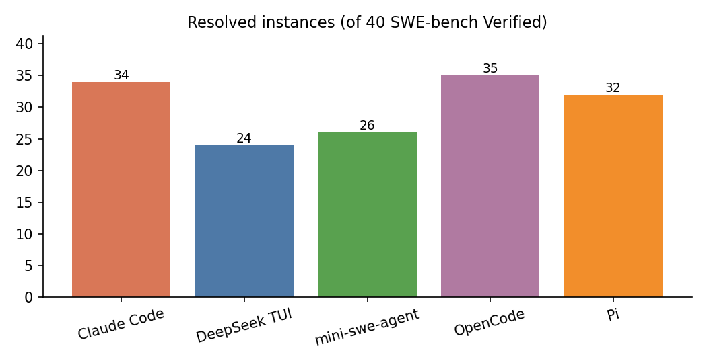
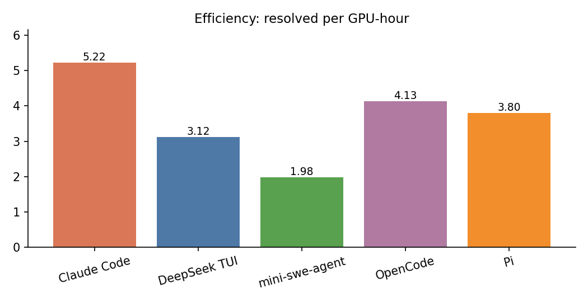
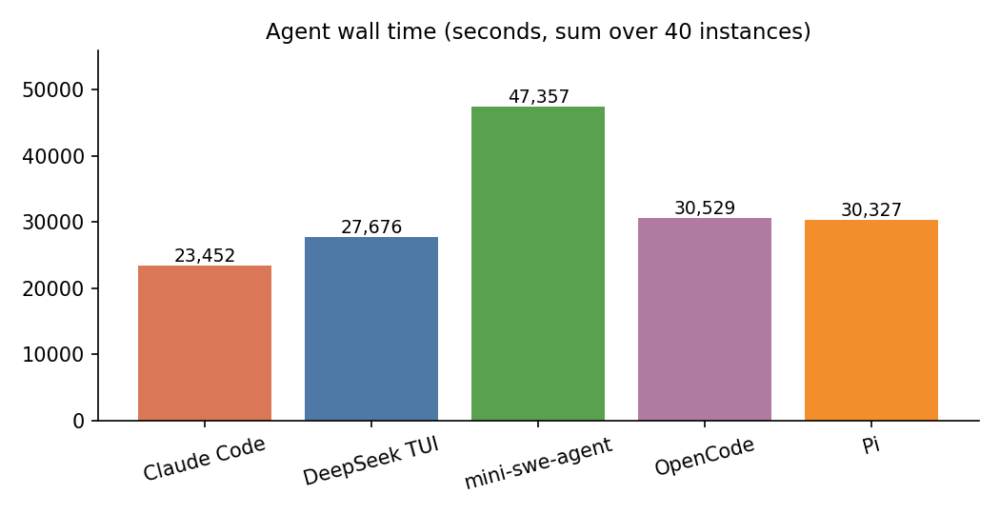
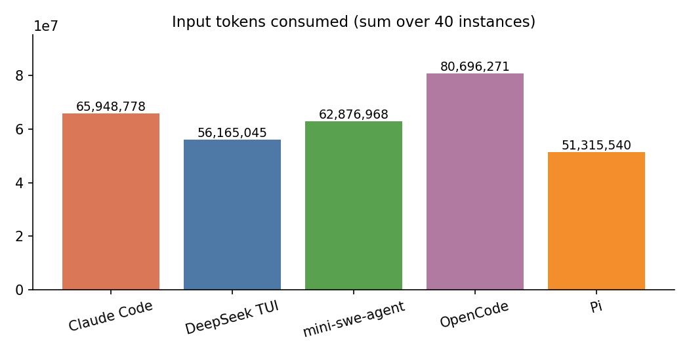
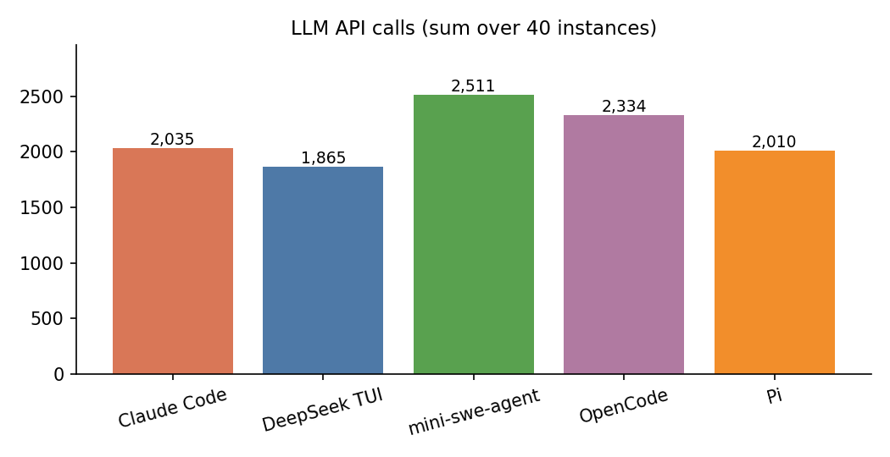
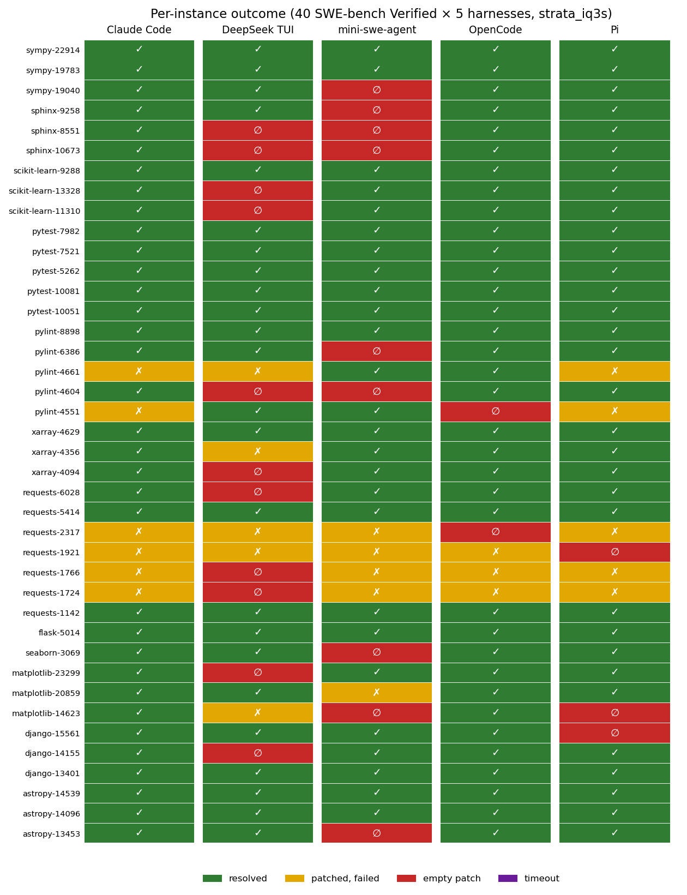

# Run 2026-11-18 — strata_iq3s × 5 harnesses, SWE-bench Verified (40)

**Question:** at n=40, do we have enough data points to distinguish a clear leader among the harnesses?

## Run card

| | |
|---|---|
| Date | 2026-11-17 13:31 → 2026-11-18 11:10 UTC (sweep + grading) |
| Model (fixed) | `strata_iq3s` (Qwen3.8-27B IQ3_S) via llama-swap, `--parallel 2`, 128k ctx, MTP |
| Dataset | 40 SWE-bench Verified instances (`sb40_new.json`) |
| Grading | official swebench F2P/P2P grader, **outside** the harness container |
| Agent loop | headless, official `swebench/sweb.eval.x86_64.*` image, 2700 s timeout, workers=2 |
| Harnesses | Claude Code 2.1.326 · DeepSeek TUI 0.2.2-rc.3 · mini-swe-agent 2.4.6 · OpenCode 2.3.0 · Pi 1.5.2 |
| Telemetry | llama-swap activity ring (per-request tokens) + per-instance wall windows |

## Results

| Harness | Resolved | Empty patches | Wall (sum) | LLM calls | Input tok | Output tok | Resolved/GPU-h |
|---|---|---|---|---|---|---|---|
| OpenCode | **35/40** | 2 | 8.48 h | 2,334 | 80.70M | 874K | 4.13 |
| Claude Code | **34/40** | 0 | 6.51 h | 2,035 | 65.95M | 905K | 5.22 |
| Pi | **32/40** | 3 | 8.42 h | 2,010 | 51.32M | 718K | 3.80 |
| mini-swe-agent | **26/40** | 9 | 13.15 h | 2,511 | 62.88M | 1.16M | 1.98 |
| DeepSeek TUI | **24/40** | 11 | 7.69 h | 1,865 | 56.17M | 791K | 3.12 |

## Charts

## Paired significance (McNemar exact)

| Pair | discordant | p | significant (0.05) |
|---|---|---|---|
| OpenCode vs Claude Code | 1 : 0 | 1.0000 | no |
| OpenCode vs Pi | 3 : 0 | 0.2500 | no |
| OpenCode vs mini-swe-agent | 10 : 1 | 0.0117 | yes |
| OpenCode vs DeepSeek TUI | 12 : 1 | 0.0034 | yes |
| Claude Code vs Pi | 2 : 0 | 0.5000 | no |
| Claude Code vs mini-swe-agent | 10 : 2 | 0.0386 | yes |
| Claude Code vs DeepSeek TUI | 11 : 1 | 0.0063 | yes |
| Pi vs mini-swe-agent | 9 : 3 | 0.1460 | no |
| Pi vs DeepSeek TUI | 10 : 2 | 0.0386 | yes |
| mini-swe-agent vs DeepSeek TUI | 8 : 6 | 0.7905 | no |

## Findings

1. **Leader: OpenCode (35/40) ≈ Claude Code (34/40)** — statistically tied on correctness (1:0 discordant). **Claude Code wins on cost**: 6.5 h vs 8.5 h wall, 5.22 vs 4.13 resolved/GPU-h, 0 empty patches vs 2.
2. **Pi (32/40) is a solid third** — not significantly behind the leaders at n=40 (p=0.25 vs OpenCode).
3. **mini-swe-agent (26) and DeepSeek TUI (24) are clearly behind** — vs OpenCode p=0.012 / p=0.003; vs Claude Code p=0.039 / p=0.006. mini is worst on efficiency too (1.98 resolved/GPU-h).

## Caveats

- Absolute scores inflated by training-set memorization of classic pre-2022 instances; the *ranking* holds because contamination is identical across harnesses.
- Nightly Hindsight consolidation overlapped the Pi phase (~37 min of shared-model traffic): Pi wall/token totals slightly inflated (low single-digit %); resolved counts unaffected.
- Two mini instances were re-run cleanly after an accidental double-sweep overlap touched their workdirs.
- Raw `activity.jsonl` telemetry (26–83 MB per harness) is kept on the rig, not committed.

## Data

- `data/results.json` — consolidated numbers (this page is generated from it)
- `data/eval_*.json` / `openai__*.json` — official swebench grader reports per harness
- `data/preds_*.json` — model patches per instance
- `data/windows_*.jsonl` — per-instance wall windows
- Reproduce: `hb.py run --harness <name> && hb.py eval --harness <name>` then `scripts/consolidate.py && scripts/render_charts.py && scripts/publish_std.py`
