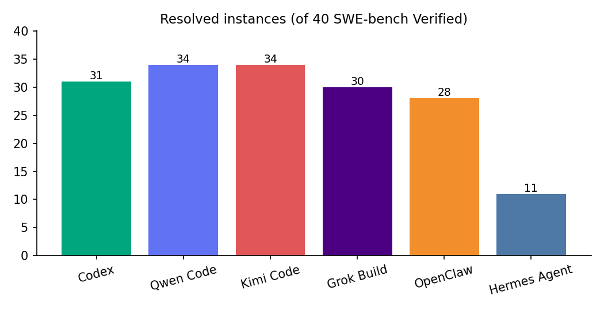
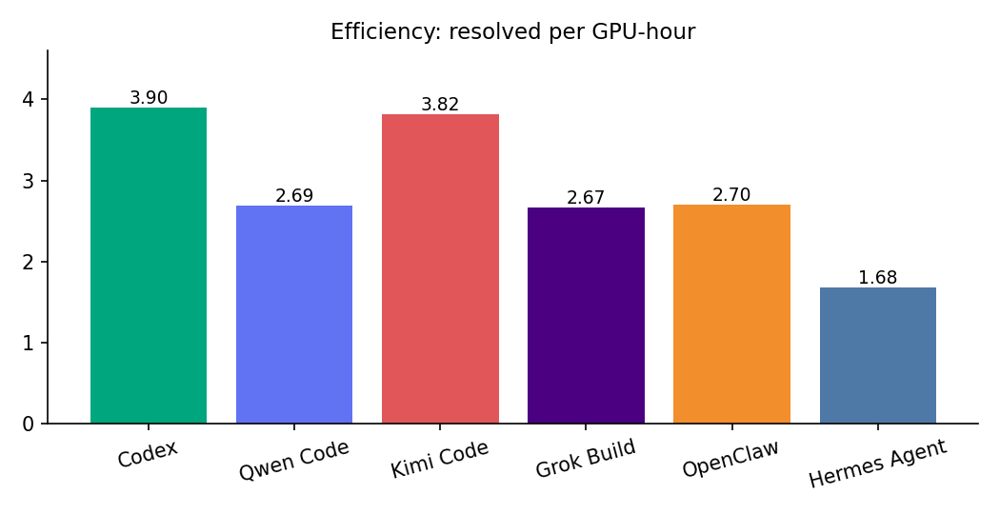
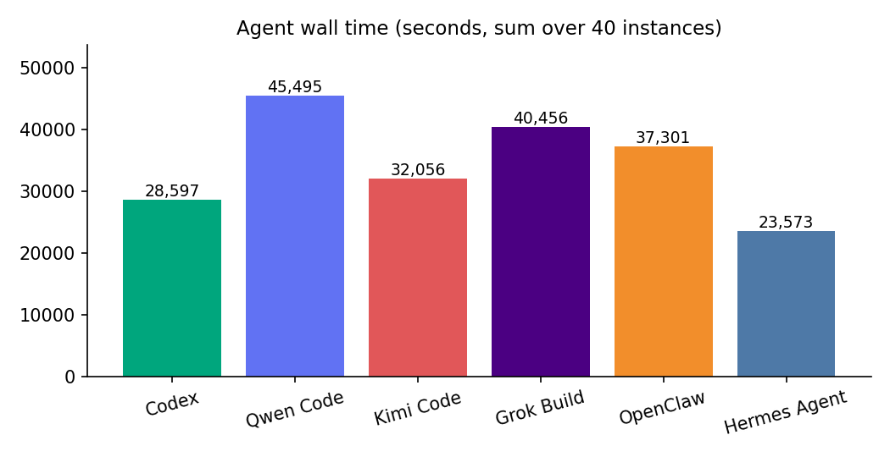
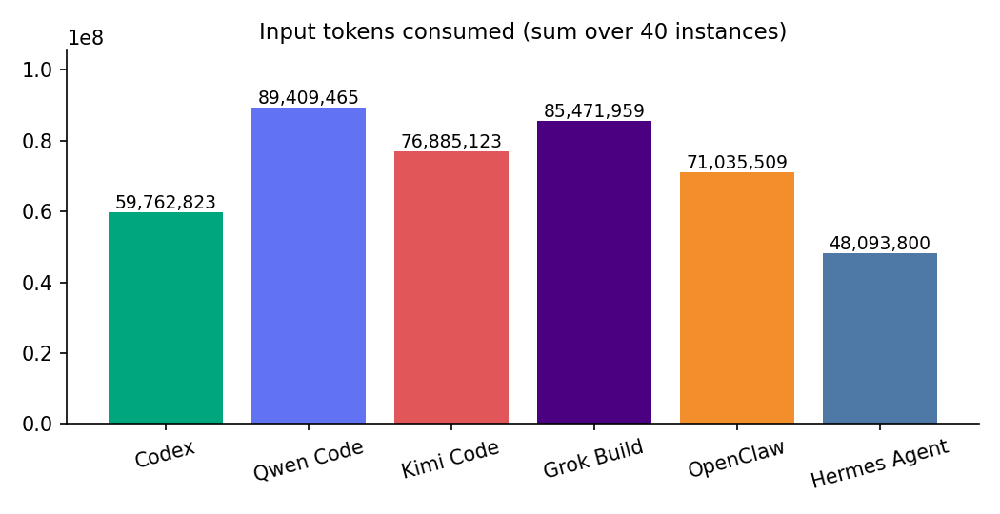
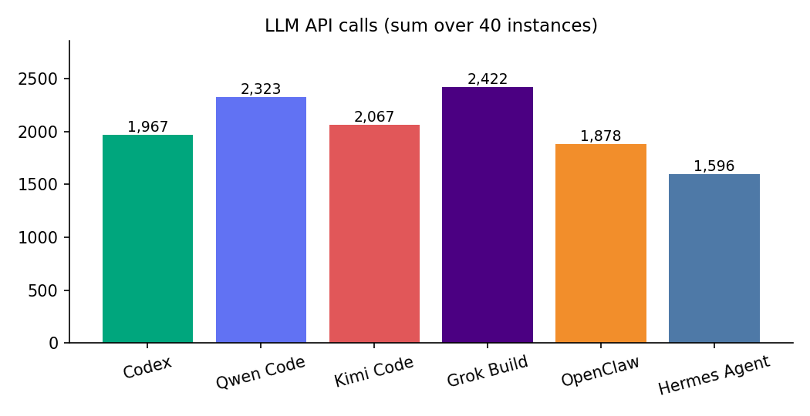
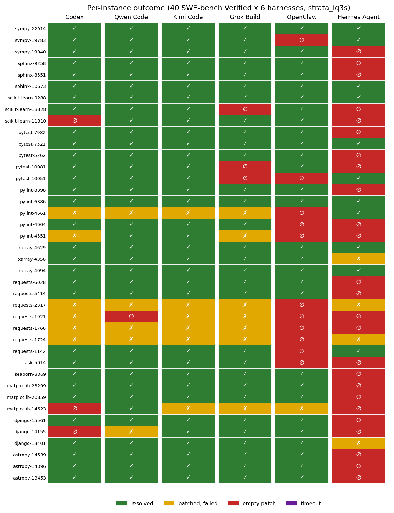
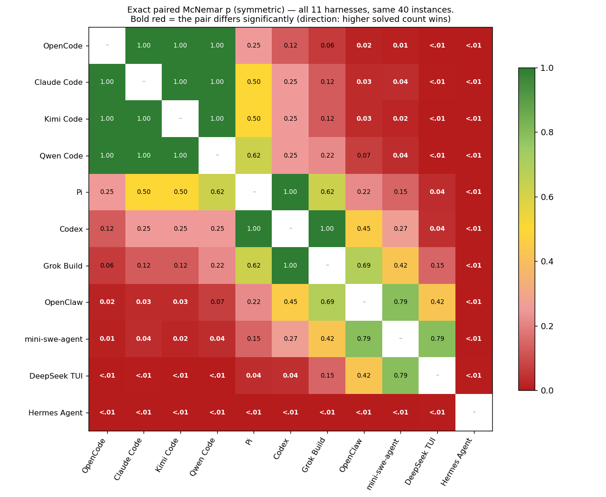
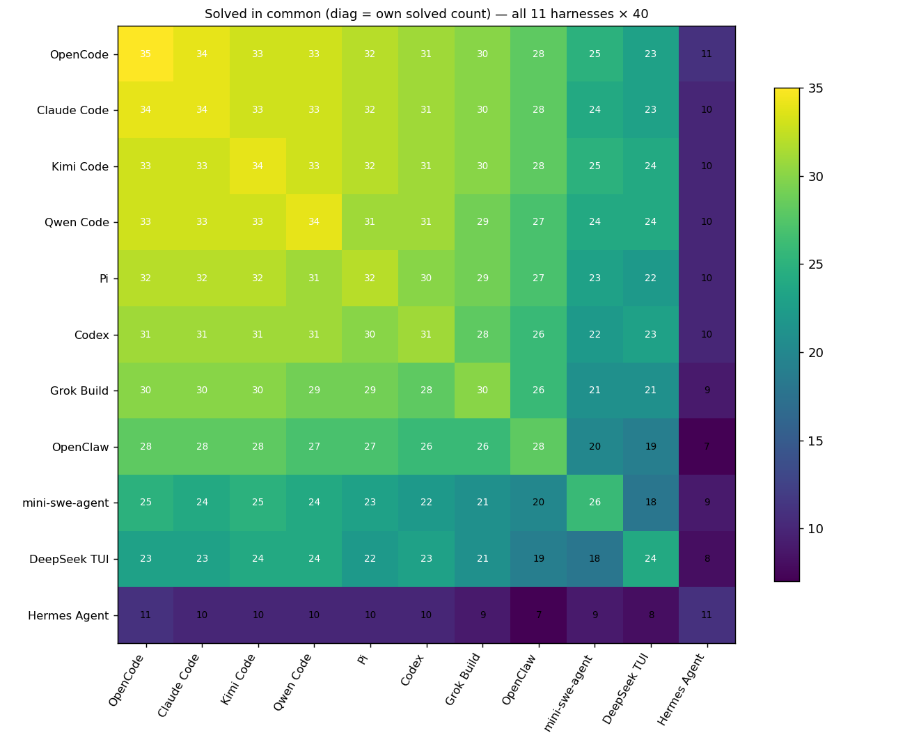

# Run 2026-11-19 — strata_iq3s × 6 new leaderboard harnesses, SWE-bench Verified (40)

**Question:** can the six harnesses newly added from the HF harness-leaderboard join the top group — and does n=40 reveal a single leader?

## Run card

| | |
|---|---|
| Date | 2026-11-18 → 2026-11-20 (openclaw 18:45 UTC 18th; codex→hermes-agent 23:56 UTC 18th → 00:43 UTC 20th; grading interleaved) |
| Model (fixed) | `strata_iq3s` (Qwen3.8-27B IQ3_S) via llama-swap `127.0.0.1:8080` |
| Serving | strata 0.2.13, `--context 128k --parallel 2 --kv k8v4 --vision cpu --mtp`, workers=2 |
| Dataset | same 40 SWE-bench Verified instances as the five-way sb40 run (`sb40_new.json`) |
| Grading | official swebench F2P/P2P grader, **outside** the harness container |
| Agent loop | headless, official `swebench/sweb.eval.x86_64.*` image, 2700 s timeout; Hermes Agent ran in its own `nousresearch/hermes-agent` image |
| Harnesses | Codex 0.170.0 · Qwen Code 0.28.0 · Kimi Code 2.6.3 · Grok Build 1.0.89 · OpenClaw 2026.6.35 · Hermes Agent 0.23.1 |
| BYOK | all harnesses pointed at llama-swap (`/v1` chat-completions; Codex via native Responses API `/v1/responses`) |
| Telemetry | llama-swap activity ring (per-request tokens) + per-instance wall windows |

## Results

| Harness | Resolved | Empty patches | Wall (sum) | LLM calls | Input tok | Output tok | Resolved/GPU-h |
|---|---|---|---|---|---|---|---|
| Qwen Code | **34/40** | 1 | 12.64 h | 2,323 | 89.41M | 1.11M | 2.69 |
| Kimi Code | **34/40** | 0 | 8.90 h | 2,067 | 76.89M | 861K | 3.82 |
| Codex | **31/40** | 3 | 7.94 h | 1,967 | 59.76M | 775K | 3.90 |
| Grok Build | **30/40** | 3 | 11.24 h | 2,422 | 85.47M | 1.00M | 2.67 |
| OpenClaw | **28/40** | 11 | 10.36 h | 1,878 | 71.04M | 815K | 2.70 |
| Hermes Agent | **11/40** | 25 | 6.55 h | 1,596 | 48.09M | 627K | 1.68 |

## Charts

## Paired significance (McNemar exact)

| Pair | discordant | p | significant (0.05) |
|---|---|---|---|
| Qwen Code vs Kimi Code | 1 : 1 | 1.0000 | no |
| Qwen Code vs Codex | 3 : 0 | 0.2500 | no |
| Qwen Code vs Grok Build | 5 : 1 | 0.2188 | no |
| Qwen Code vs OpenClaw | 7 : 1 | 0.0703 | no |
| Qwen Code vs Hermes Agent | 24 : 1 | 0.0000 | yes |
| Kimi Code vs Codex | 3 : 0 | 0.2500 | no |
| Kimi Code vs Grok Build | 4 : 0 | 0.1250 | no |
| Kimi Code vs OpenClaw | 6 : 0 | 0.0312 | yes |
| Kimi Code vs Hermes Agent | 24 : 1 | 0.0000 | yes |
| Codex vs Grok Build | 3 : 2 | 1.0000 | no |
| Codex vs OpenClaw | 5 : 2 | 0.4531 | no |
| Codex vs Hermes Agent | 21 : 1 | 0.0000 | yes |
| Grok Build vs OpenClaw | 4 : 2 | 0.6875 | no |
| Grok Build vs Hermes Agent | 21 : 2 | 0.0001 | yes |
| OpenClaw vs Hermes Agent | 21 : 4 | 0.0009 | yes |

## Findings

1. **Qwen Code and Kimi Code join the top group** — 34/40 each, statistically indistinguishable from OpenCode 35 and Claude Code 34 (all pairs p=1.0). At n=40 there is a four-way tie at the top, not a single leader.
2. **Codex 31/40 and Grok 30/40 form a solid mid tier** — not distinguishable from the top group at this n, but far from the tail.
3. **OpenClaw 28/40 is significantly below the leaders** (vs OpenCode p=0.016, Claude Code & Kimi Code p=0.031) and paid for it with 11 empty patches.
4. **Hermes Agent 11/40 finishes last — with a hard infra caveat** (see below): 16/40 runs died on its own gateway-disconnect failure before doing any work; among the 24 runs that completed normally it still resolved 11 (46% vs Qwen Code's 94% on completed runs).
5. **Efficiency crown stays with the original pair** — best of the new six is Kimi Code at 3.82 resolved/GPU-h, still below Claude Code (5.22) and OpenCode (6.22) from the five-way run; Qwen Code (2.69) and Grok (2.67) burn the most wall per solve.
6. **Reliability clean-sheet again for Kimi Code** — 0 empty patches, matching Claude Code; Qwen Code near-perfect with 1.

## Paired significance — full 11-way matrix

Same 40 instances as the 2026-11-18 five-way run, same model → every pair across both runs is directly comparable.

| Row harness (solved) | OpenCode | Claude Code | Kimi Code | Qwen Code | Pi | Codex | Grok Build | OpenClaw | mini-swe-agent | DeepSeek TUI | Hermes Agent |
|---|---|---|---|---|---|---|---|---|---|---|---|
| **OpenCode** (35/40) | – | 1.000 | 1.000 | 1.000 | 0.250 | 0.125 | 0.062 | 0.016 | 0.012 | 0.003 | <.001 |
| **Claude Code** (34/40) | 1.000 | – | 1.000 | 1.000 | 0.500 | 0.250 | 0.125 | 0.031 | 0.039 | 0.006 | <.001 |
| **Kimi Code** (34/40) | 1.000 | 1.000 | – | 1.000 | 0.500 | 0.250 | 0.125 | 0.031 | 0.021 | 0.002 | <.001 |
| **Qwen Code** (34/40) | 1.000 | 1.000 | 1.000 | – | 0.625 | 0.250 | 0.219 | 0.070 | 0.039 | 0.002 | <.001 |
| **Pi** (32/40) | 0.250 | 0.500 | 0.500 | 0.625 | – | 1.000 | 0.625 | 0.219 | 0.146 | 0.039 | <.001 |
| **Codex** (31/40) | 0.125 | 0.250 | 0.250 | 0.250 | 1.000 | – | 1.000 | 0.453 | 0.267 | 0.039 | <.001 |
| **Grok Build** (30/40) | 0.062 | 0.125 | 0.125 | 0.219 | 0.625 | 1.000 | – | 0.688 | 0.424 | 0.146 | <.001 |
| **OpenClaw** (28/40) | 0.016 | 0.031 | 0.031 | 0.070 | 0.219 | 0.453 | 0.688 | – | 0.791 | 0.424 | <.001 |
| **mini-swe-agent** (26/40) | 0.012 | 0.039 | 0.021 | 0.039 | 0.146 | 0.267 | 0.424 | 0.791 | – | 0.791 | <.001 |
| **DeepSeek TUI** (24/40) | 0.003 | 0.006 | 0.002 | 0.002 | 0.039 | 0.039 | 0.146 | 0.424 | 0.791 | – | 0.004 |
| **Hermes Agent** (11/40) | <.001 | <.001 | <.001 | <.001 | <.001 | <.001 | <.001 | <.001 | <.001 | 0.004 | – |

**Pairs with p < 0.05:** OpenCode vs Hermes Agent (p=0.000); Claude Code vs Hermes Agent (p=0.000); Kimi Code vs Hermes Agent (p=0.000); Qwen Code vs Hermes Agent (p=0.000); Pi vs Hermes Agent (p=0.000); Codex vs Hermes Agent (p=0.000); Grok Build vs Hermes Agent (p=0.000); mini-swe-agent vs Hermes Agent (p=0.001); OpenClaw vs Hermes Agent (p=0.001); Kimi Code vs DeepSeek TUI (p=0.002); Qwen Code vs DeepSeek TUI (p=0.002); OpenCode vs DeepSeek TUI (p=0.003); DeepSeek TUI vs Hermes Agent (p=0.004); Claude Code vs DeepSeek TUI (p=0.006); OpenCode vs mini-swe-agent (p=0.012); OpenCode vs OpenClaw (p=0.016); Kimi Code vs mini-swe-agent (p=0.021); Claude Code vs OpenClaw (p=0.031); Kimi Code vs OpenClaw (p=0.031); Claude Code vs mini-swe-agent (p=0.039); Qwen Code vs mini-swe-agent (p=0.039); Pi vs DeepSeek TUI (p=0.039); Codex vs DeepSeek TUI (p=0.039).

## Caveats

- Hermes Agent's daemon architecture (gateway + unix socket) is fragile inside disposable containers: 16/40 runs exited 1 with `Gateway disconnected` and produced no trajectory. Treat 11/40 as its harness-integration floor, not its capability ceiling. Its runs also benefited from no Hindsight cron contention (cron paused all sweep).
- OpenClaw's 11 empty patches include suspected session-state interference at workers=2 (shared config home) — re-test at workers=1 before trusting its rank relative to Codex/Grok.
- Harness versions float: these are the Nov-2026 builds; upstream harnesses update fast.
- n=40 still cannot separate the four leaders; separating 34 from 35 needs ~150+ instances.
- Absolute scores inflated by training-set memorization of pre-2022 instances; ranking stays valid (contamination constant across harnesses).

## Data

- `data/results.json` — consolidated numbers (this page is generated from it)
- `data/eval_*.json` / `openai__*.json` — official swebench grader reports per harness
- `data/preds_*.json` — model patches per instance
- `data/windows_*.jsonl` — per-instance wall windows
- Reproduce: `hb.py run --harness <name> && hb.py eval --harness <name>` then `scripts/consolidate.py && scripts/render_charts.py && scripts/publish_std.py`
